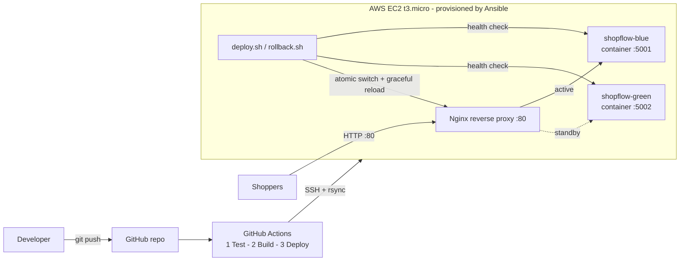

# ShopFlow — E-Commerce Zero-Downtime Deployment System

ShopFlow is a small online-shop demo app with an automated deployment pipeline built around it. New versions go live **without downtime**: if a release is broken it never gets live traffic, and if something goes wrong after the switch the system rolls back by itself.

| | |
|---|---|
| **Live app** | http://3.80.226.178 |
| **Health check** | http://3.80.226.178/health |
| **Status API** | http://3.80.226.178/api/status |
| **Repository** | https://github.com/sagniksannigrahi/E-Commerce-Zero-Downtime-Deployment-System |

---

## 1. Problem statement

> An e-commerce company faces frequent deployment failures, manual server setup, and downtime during releases.

| Problem | Solution in this project |
|---|---|
| Frequent deployment failures | **GitHub Actions CI/CD**: every push runs 33 automated tests and builds/smoke-tests the Docker image. Code that fails is never deployed. |
| Manual server setup | **Ansible playbook** installs and configures Docker, Docker Compose, Nginx, swap, directories and permissions with one command. Running it again is safe (idempotent). |
| Downtime during releases | **Blue-Green deployment** with Docker + Nginx: the new version starts next to the old one, is health-checked, and traffic is switched only when it is healthy. |

## 2. Technologies

| Area | Tool |
|---|---|
| Application | Python 3.12, Flask, Gunicorn, HTML/CSS/JavaScript |
| Containers | Docker, Docker Compose |
| Reverse proxy / traffic switch | Nginx |
| Server provisioning | Ansible |
| CI/CD | Git, GitHub, GitHub Actions |
| Hosting | One AWS EC2 t3.micro (Ubuntu 26.04 LTS) |
| Testing | Pytest |

No database, Kubernetes, Terraform, Jenkins or load balancer is used — the whole system runs on one small EC2 instance.

## 3. Architecture



The same picture as plain text:

```
                     ┌──────────────────────── AWS EC2 (t3.micro) ────────────────────────┐
 Shoppers ──HTTP:80──►  Nginx  ──► active_upstream.conf ──►  BLUE  container  :5001  (live)  │
                     │                                    └╌╌►  GREEN container  :5002  (standby)
 git push ─► GitHub Actions ─(SSH)─► deploy.sh: build ► start idle colour ► health check ►   │
                     │                        switch Nginx ► verify ► (rollback if needed)  │
                     └────────────────────────────────────────────────────────────────────┘
```

The containers listen on `127.0.0.1` only, so the internet can reach them **only through Nginx**.

## 4. Project structure

```
shopflow-zero-downtime/
├── app.py                     Flask app (shop pages, cart API, /health, /api/status)
├── VERSION                    Release version shown in the UI (bump it to release)
├── requirements.txt           Runtime dependencies (Flask, Gunicorn)
├── requirements-dev.txt       + Pytest
├── Dockerfile                 Small, non-root image with a built-in HEALTHCHECK
├── docker-compose.yml         Two services: shopflow-blue (:5001) and shopflow-green (:5002)
├── ansible/
│   ├── ansible.cfg
│   ├── inventory.ini          The existing EC2 instance (key path only, never the key)
│   └── playbook.yml           Server provisioning
├── deployment/
│   ├── deploy.sh              Blue-green deployment with health checks and auto-rollback
│   ├── rollback.sh            Instant manual rollback to the standby colour
│   ├── lib.sh                 Shared helpers (locking, health checks, Nginx switching)
│   ├── status.sh              Shows live colour, containers and deployment history
│   ├── push-release.sh        Deploy from a laptop the same way CI does
│   ├── traffic-monitor.sh     Sends 4 requests/second to prove zero downtime
│   └── nginx/shopflow.conf    Nginx reverse-proxy site
├── templates/index.html       Shop dashboard
├── static/style.css, script.js
├── tests/
│   ├── test_app.py            22 app tests
│   └── test_deploy_script.py  11 tests of the deployment/rollback logic
├── docs/demo-guide.md         5–7 minute live demo plan + viva questions
└── .github/workflows/
    ├── deploy.yml             CI/CD: test -> build -> blue-green deploy (on push to main)
    └── operations.yml         Buttons for provision / status / rollback / simulate-failure / deploy
```

## 5. The application

ShopFlow is deliberately simple: 8 products held in memory, a cart, and a demo checkout. It exists to show off the deployment system.

* **Homepage** — product dashboard, category filters, search, cart drawer, order confirmation.
* **Deployment ribbon** — the coloured bar at the top shows which environment (BLUE/GREEN), version and build is serving you.
* **Deployment monitor panel** — calls `/api/status` every 2 seconds and draws a coloured tick per response (red = failed). During a release you watch it change colour with **no red ticks**.
* **Cart survives deployments** — the cart lives in a signed cookie; blue and green share the same secret key, so a shopper's cart is still there after the switch.

| Endpoint | Purpose |
|---|---|
| `GET /` | Shop homepage |
| `GET /health` | `{"status":"healthy","color":"blue","version":"1.0.0","build":"…","release":"…"}` — used by deploy.sh, Docker and GitHub Actions |
| `GET /api/status` | Version, colour, container hostname, uptime |
| `GET /api/products`, `/api/products/<id>` | Catalogue |
| `GET /api/cart`, `POST /api/cart/add`, `/api/cart/remove`, `/api/cart/clear` | Cart |
| `POST /api/checkout` | Demo order confirmation |

## 6. How Ansible automates server setup

`ansible/playbook.yml` turns a fresh Ubuntu instance into a deployment host:

1. Updates the apt package index (skipped if refreshed in the last hour).
2. Installs Docker Engine, the Docker Compose plugin and Buildx from the Ubuntu archive.
3. Installs Nginx.
4. Turns on Docker log rotation so logs cannot fill the 8 GB disk.
5. Enables and starts Docker and Nginx at boot.
6. Adds `ubuntu` to the `docker` group.
7. Creates a 1 GB swap file. A t3.micro has only 1 GB of RAM, and swap keeps Docker builds from running out of memory.
8. Creates `/opt/shopflow/{releases,state}` and `/etc/nginx/shopflow` owned by the deploy user.
9. Installs the Nginx site, disables the default site and validates the config with `nginx -t`.
10. Adds a narrow sudoers rule so the deploy user can run only `nginx -t` and `systemctl reload nginx`.
11. Prints the installed versions and checks that Nginx answers.

**Idempotent** means it describes the *desired state* rather than steps to repeat. On a second run Ansible sees that everything already matches and reports `changed=0`.

```bash
cd ansible
ansible-playbook playbook.yml            # provision / re-check the server
ansible-playbook playbook.yml --check    # dry run: show what would change
```

## 7. How GitHub Actions works

`.github/workflows/deploy.yml` runs on every push to `main`:

| Job | What it does | If it fails |
|---|---|---|
| **1. Run automated tests** | Installs dependencies, runs `pytest -v` (33 tests) | Pipeline stops — nothing is built or deployed |
| **2. Build & smoke-test image** | `docker build`, starts the container, calls `/health` | Pipeline stops — nothing is deployed |
| **3. Blue-Green deploy** | Copies the code to a new folder on EC2 over SSH, runs `deploy.sh`, then checks the **public** `/health` returns the new build | The job fails and the summary says so. `deploy.sh` has already kept traffic on the old version. |

Pull requests run jobs 1–2 only. `concurrency: shopflow-production` stops two deployments from running at once.

### Required repository secrets

Set these under **Settings → Secrets and variables → Actions**:

| Secret | Value |
|---|---|
| `EC2_HOST` | `3.80.226.178` |
| `EC2_USER` | `ubuntu` |
| `EC2_SSH_KEY` | Full contents of the private `.pem` key, including the BEGIN/END lines |
| `EC2_KNOWN_HOSTS` | The server's verified host key line (`ssh-keyscan -t ed25519 3.80.226.178`, after checking the fingerprint matches the server's) |

Or with the GitHub CLI (the key is read straight from the file and never shown):

```bash
gh secret set EC2_HOST --body 3.80.226.178
gh secret set EC2_USER --body ubuntu
gh secret set EC2_SSH_KEY < ~/Downloads/CloudDeploy-Deploy-Key.pem
ssh-keyscan -t ed25519 3.80.226.178 | gh secret set EC2_KNOWN_HOSTS
```

The security group must allow **SSH (22) from 0.0.0.0/0**, because GitHub's runners use changing IP addresses. Password login is disabled on the server, so only the key holder can log in.

## 8. How Blue-Green deployment works

There are always two slots on the server: **BLUE** (port 5001) and **GREEN** (port 5002). Nginx sends users to one of them. The Nginx file `/etc/nginx/shopflow/active_upstream.conf` records which one is live:

```nginx
server 127.0.0.1:5001;   # blue is live
```

`deployment/deploy.sh` does this:

1. **Lock.** It creates a lock directory. `mkdir` is atomic, so a second deployment started at the same time stops with "Another deployment is already running".
2. **Find the live colour** from the Nginx file. The *other* colour becomes the target.
3. **Build** a new image with the version, commit and a unique release ID baked in.
4. **Start the target colour.** The live colour is not touched and keeps serving users.
5. **Health-check the target directly** (`http://127.0.0.1:500X/health`, up to 60 seconds). It must answer `healthy` with the correct colour *and* the new release ID.
6. **Switch atomically.** Write the new upstream to a temporary file, then `mv` it over the old one (a rename is atomic, so Nginx never reads a half-written file). Then run `nginx -t` and **reload gracefully**: new Nginx workers start with the new upstream, old workers finish the requests they are already serving, and no connection is dropped.
7. **Verify through Nginx.** It needs 3 consecutive responses from the new colour via port 80.
8. **Keep the old colour running** as a hot standby for instant rollback, and remove unused images and old release folders.

## 9. How health checks work

Health is checked at four levels:

| Where | What |
|---|---|
| Docker `HEALTHCHECK` | Every 10 seconds inside the container. `docker ps` shows `(healthy)`. |
| `deploy.sh` before switching | Calls the new container directly. Traffic switches only if it is healthy **and** running the exact new release. |
| `deploy.sh` after switching | Calls through Nginx to prove real traffic reaches the new version. |
| GitHub Actions | Calls the public URL `http://3.80.226.178/health` and checks for the new commit. |

Containers also use `restart: unless-stopped`, so Docker restarts a crashed app automatically.

## 10. How automatic rollback works

| Failure | What happens |
|---|---|
| Tests fail in CI | Nothing is built or deployed |
| New container fails to start | Traffic is never switched; the old version keeps serving |
| New version fails its health check | The new container is stopped and **traffic is never switched** ("Deployment ABORTED. Traffic was NOT switched") |
| `nginx -t` rejects the new config | The previous upstream file is restored |
| Checks through Nginx fail after the switch | **Automatic rollback**: the previous upstream file is restored, Nginx is reloaded and the new container is stopped |
| Bug found later by a human | `rollback.sh` switches back to the standby colour in about 2 seconds, with no rebuild |

You can safely try a broken release at any time:

```bash
deployment/push-release.sh --simulate-failure   # its /health returns 503 on purpose
```

## 11. Run locally

```bash
# Option A - Python only
python3 -m venv .venv && source .venv/bin/activate
pip install -r requirements-dev.txt
pytest -v                     # 33 tests
python app.py                 # http://localhost:5000

# Option B - Docker (both colours)
docker compose up --build     # blue: http://localhost:5001  green: http://localhost:5002
docker compose down
```

## 12. Deploy changes

**Normal way (CI/CD):**

```bash
echo "1.1.0" > VERSION        # and/or change code
git commit -am "Release 1.1.0"
git push origin main          # GitHub Actions tests, builds and deploys
```

**From your laptop** (the same steps CI runs, handy for demos):

```bash
deployment/push-release.sh                      # normal blue-green deploy
deployment/push-release.sh --simulate-failure   # show that a broken release is refused
```

**On the server:**

```bash
ssh -i ~/Downloads/CloudDeploy-Deploy-Key.pem ubuntu@3.80.226.178
R=$(ls -1dt /opt/shopflow/releases/*/ | head -1)
bash $R/deployment/status.sh      # live colour, containers, history
bash $R/deployment/rollback.sh    # instant rollback to the standby colour
```

**Re-provision:** `cd ansible && ansible-playbook playbook.yml`

**From GitHub (no SSH needed on your network):** Actions → **Operations** → *Run workflow* → choose `provision`, `status`, `rollback`, `simulate-failure` or `deploy`. GitHub's servers do the SSH work, which helps when campus Wi-Fi blocks port 22. CLI equivalent:

```bash
gh workflow run operations.yml -f action=rollback
```

## 13. Demonstrating to a professor

See **[docs/demo-guide.md](docs/demo-guide.md)** for a timed 5–7 minute script and viva questions with answers. In short:

1. Open http://3.80.226.178 and point out the colour ribbon and the deployment monitor.
2. In a terminal, run `deployment/traffic-monitor.sh` (4 requests per second).
3. Push a version bump, or run `push-release.sh`. The colour flips BLUE ↔ GREEN with **0 failed requests**.
4. Run `push-release.sh --simulate-failure`. The deployment is refused and the site stays up.
5. Run `rollback.sh`. Traffic is back on the previous version in about 2 seconds.

## 14. Limitations

* **One EC2 instance means no high availability.** Blue-green removes downtime *during releases*, but if the instance, its availability zone or its disk fails, the site goes down. Real production would use two or more instances in different availability zones behind a load balancer (e.g. AWS ALB + Auto Scaling). That was out of scope here to keep the project free-tier friendly.
* **Plain HTTP.** No domain or TLS certificate. Production would add HTTPS (e.g. Let's Encrypt).
* **Images are built on the server.** Fine for one instance. A bigger setup would push images to a registry (ECR/GHCR) and pull them.
* **Products are in memory and there is no database.** Orders are not stored, by design. A schema change would need backward-compatible migrations, which blue-green does not solve on its own.
* **The public IP is not an Elastic IP.** It changes if the instance is stopped and started; update `EC2_HOST` and `ansible/inventory.ini` if that happens.
* **SSH is open to 0.0.0.0/0** so GitHub-hosted runners can connect. Only key authentication is accepted. A stricter setup would use a self-hosted runner or AWS SSM.
